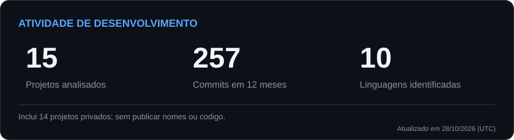
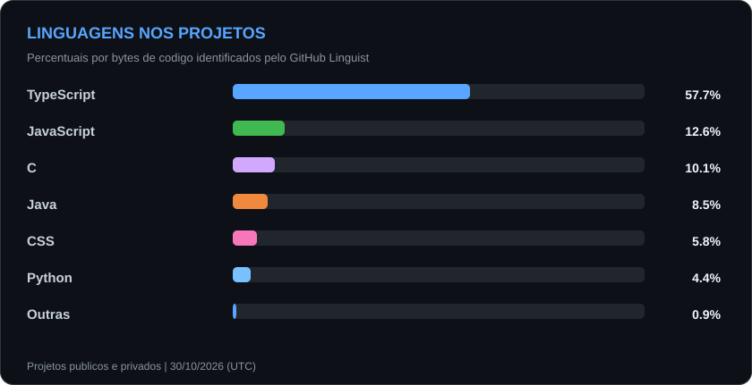

# Kauê Ajure

<picture>
  
</picture>

### 👨‍💻 Sobre mim

Sou desenvolvedor **Full Stack** e trabalho na construção de aplicações web completas, sistemas de gestão, plataformas SaaS e ferramentas internas.

Atuo do front-end ao back-end, incluindo APIs, autenticação, integrações, comunicação em tempo real, bancos de dados e deploy em ambientes Linux.

- **Frontend:** React, Next.js, TypeScript e Tailwind CSS
- **Backend:** Node.js, Express, APIs REST e Socket.IO
- **Dados e infraestrutura:** MySQL, SQL Server, Git e Linux

<picture>
  
</picture>

### ⚡ Tech Stack

<picture>
  
</picture>

### 🚀 Projetos — showcase

Uma seleção de produtos, plataformas, jogos e ferramentas que desenvolvi. As apresentações abaixo mostram a proposta e as funcionalidades de cada projeto, **sem expor o código-fonte**.

> 🔒 **Código privado, apresentação pública.** Os repositórios de implementação são privados. Este perfil reúne apenas informações de demonstração dos projetos.

#### 🎮 Produtos e experiências digitais

<table>
<tr>
<td width="50%" valign="top">
<h3>🎬 Flixa</h3>

<strong>Entretenimento, conteúdo e comunidade</strong>

<a href="https://flixa.fun/">Acessar flixa.fun ↗</a>

Plataforma web com catálogo, biblioteca pessoal, recursos sociais, comunidades e uma área esportiva com agenda e resultados.

Next.js · React · TypeScript · MySQL

</td>
<td width="50%" valign="top">
<h3>⚽ Viztto Fut</h3>

<strong>Simulador de carreira no futebol</strong>

Experiência de evolução de um atleta com treinos, decisões de carreira e passagem do tempo, sem partidas controladas diretamente.

Next.js · TypeScript · Simulação esportiva

</td>
</tr>
<tr>
<td colspan="2" valign="top">
<h3>⚔️ Battle Royale Minecraft</h3>

<strong>Modo competitivo desenvolvido como plugin para Minecraft</strong>

Partidas com arena, loot finito, raridades, habilidades, eventos e airdrops, mantendo o combate e a construção dentro da experiência Minecraft.

Java · Paper · Minecraft Server

</td>
</tr>
</table>

#### 🧩 Plataformas e soluções para negócios

<table>
<tr>
<td width="50%" valign="top">
<h3>🎫 Gestifique</h3>

<strong>Gestão de atendimento e suporte</strong>

Central de chamados com SLA, portal do cliente, base de conhecimento, indicadores, automações e atualizações em tempo real.

React · TypeScript · Node.js · MySQL · Socket.IO

</td>
<td width="50%" valign="top">
<h3>🏛️ Portal Meta</h3>

<strong>Gestão operacional e acompanhamento de demandas</strong>

Sistema com chamados, usuários, agenda, relatórios e acompanhamento de obrigações e indicadores por município.

React · TypeScript · Node.js · MySQL

</td>
</tr>
<tr>
<td width="50%" valign="top">
<h3>🏠 Kalebe Corretor</h3>

<strong>Portal de imóveis e administração de anúncios</strong>

<a href="https://kalebecorretor.com.br/">Acessar kalebecorretor.com.br ↗</a>

Vitrine imobiliária com busca, filtros, páginas de imóveis, galerias de mídia e painel administrativo para gerenciamento do catálogo.

Next.js · React · MySQL

</td>
<td width="50%" valign="top">
<h3>🏡 Alonso Imobiliária</h3>

<strong>Experiência web para o setor imobiliário</strong>

<a href="https://alonsoimobiliaria.com.br/">Acessar alonsoimobiliaria.com.br ↗</a>

Projeto de aplicação digital voltado à apresentação de uma operação imobiliária, com estrutura web moderna.

Next.js · React · TypeScript · MySQL

</td>
</tr>
<tr>
<td colspan="2" valign="top">
<h3>☀️ Aba Sol Energia</h3>

<strong>Projeto digital para o segmento de energia solar</strong>

<a href="https://abasolenergia.com.br/">Acessar abasolenergia.com.br ↗</a>

Iniciativa web voltada à presença e apresentação digital de uma marca do setor energético.

</td>
</tr>
</table>

#### 🛠️ Ferramentas e desenvolvimento

<table>
<tr>
<td width="50%" valign="top">
<h3>🖥️ AJR Connect</h3>

<strong>Cliente de área de trabalho remota para Linux</strong>

Aplicativo com gerenciamento de conexões RDP, sessões Windows, reconexão e controles integrados de compartilhamento.

Linux · GTK4 · FreeRDP

</td>
<td width="50%" valign="top">
<h3>📍 Maps Leads</h3>

<strong>Extensão para organização de leads</strong>

Ferramenta para organizar informações públicas de empresas visualizadas no Google Maps, com painel, filtros e exportação.

Chrome Extension · Manifest V3 · JavaScript

</td>
</tr>
<tr>
<td colspan="2" valign="top">
<h3>🌐 Portfólio e gestão profissional</h3>

<strong>Presença digital e ferramentas de trabalho</strong>

Site pessoal com administração de clientes, agenda, notas, propostas e funcionalidades de apoio a serviços digitais.

Next.js · Supabase · PostgreSQL

<a href="https://kaueajure.website/">Conhecer o portfólio ↗</a>

</td>
</tr>
</table>

As descrições apresentam o propósito dos projetos. Repositórios privados não disponibilizam o código ao público.

<picture>
  
</picture>

### 📊 GitHub

Os dados são atualizados diariamente pelo GitHub Actions após autorização de leitura. **Commits** = commits atribuídos à conta nos últimos 365 dias, nas branches principais dos repositórios acessíveis; podem diferir do total de contribuições do calendário. **Linguagens** = proporção de bytes detectados pelo GitHub Linguist. Os gráficos não revelam nomes nem arquivos de repositórios privados.

<picture>
  <source media="(prefers-color-scheme: dark)" srcset="https://raw.githubusercontent.com/kaueajure/kaueajure/output/github-contribution-grid-snake-dark.svg?v=ajr7" />
  <source media="(prefers-color-scheme: light)" srcset="https://raw.githubusercontent.com/kaueajure/kaueajure/output/github-contribution-grid-snake.svg?v=ajr7" />
  
</picture>

